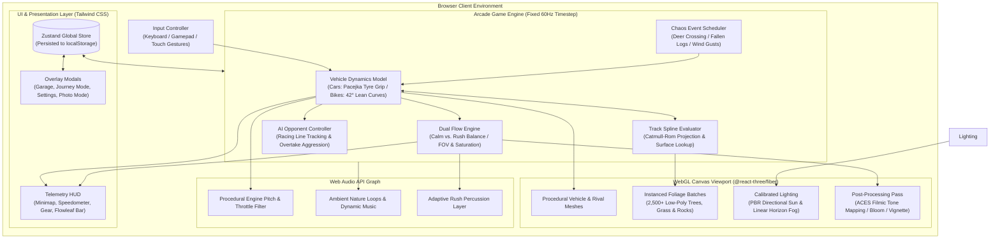

<div align="center">

# 🌲 VERDANT RUSH
### *"Breathe in. Floor it."*

**A calm, sunlit 3D forest racing game for the browser that fuses serene nature exploration with high-speed arcade driving to help players decompress.**

<br />

[](https://github.com/goateddhleminh/verdant-rush/releases)
[](https://github.com/goateddhleminh/verdant-rush/actions)
[](https://opensource.org/licenses/MIT)
[](https://threejs.org/)
[](https://react.dev/)
[](https://www.typescriptlang.org/)
[](https://vitejs.dev/)
[](https://tailwindcss.com/)

<br />


<br />
<br />

[🎮 **Play Live Demo**](https://verdant-rush.vercel.app) &nbsp;•&nbsp; [📖 **System Architecture**](#-tech-stack--architecture) &nbsp;•&nbsp; [🕹️ **Quick Start**](#-frictionless-quick-start--60s) &nbsp;•&nbsp; [🐛 **Report Bug**](https://github.com/goateddhleminh/verdant-rush/issues)

</div>

---

## ⚡ Core Features

- **🏎️ Dual Arcade Vehicle Dynamics**: Features custom Pacejka-derived tyre grip and counter-steer assist for drift cars alongside authentic 42° lean-angle motorbike physics with throttle wheelies, stoppies, and instantaneous self-righting stability—all engineered in pure TypeScript with allocation-free 60+ FPS loops.
- **☯️ Bi-Directional Flow System**: Harmonizes relaxation and adrenaline via an active see-saw Calm/Rush meter. Cruising smoothly along the racing line rewards cash-yielding **Zen Laps** and warm acoustic filtering, while aggressive drifts, drafting, and jumps trigger **Rush Time** (6 seconds of free unlimited nitro, kinetic speed lines, and widened FOV).
- **🌲 Handcrafted Procedural Forest Circuits**: Race across three lush wilderness biomes (Emerald Valley, Amber Woods, Lakeside Haven) sampled along closed Catmull-Rom 3D splines with authentic road banking, covered timber bridges, elevation drops, and an optional **Gentle Rain** variant with reduced friction and rainbow finishes.
- **🛡️ Zero-Punishment Collision Dynamics**: Replaces punitive game-overs, mechanical damage, and jarring crash sounds with gentle speed scrub and soft deflections. Navigate interactive chaos events—crossing deer, fallen branches, pebble slides, and puddles—designed to challenge reflexes without frustration.
- **🏆 12-Event Career & Modular Tuning**: Progress through three championship cups (*Sprout Cup, Canopy Cup, Summit Cup*), tune your ride on a 3D turntable garage with 4 performance upgrade tiers (Engine, Tyres, Nitro, Chassis), apply custom liveries, and shoot high-res photos in a full-featured **Photo Mode**.
- **🎧 Dynamic Web Audio Soundscape**: Multi-bus audio mixing architecture featuring real-time procedural engine rev synthesis, tyre scrub filters, spatialized environmental birdsong, ambient wind loops, and dynamic percussion that automatically fades in during Rush bursts.

---

## 🕹️ Controls Guide

| Action | Keyboard | Gamepad (Xbox / Standard) | Touch Device |
| :--- | :--- | :--- | :--- |
| **Accelerate** | <kbd>W</kbd> / <kbd>▲</kbd> | Right Trigger (<kbd>RT</kbd>) | Virtual Throttle Pedal |
| **Steer** | <kbd>A</kbd> / <kbd>D</kbd> or <kbd>◄</kbd> / <kbd>►</kbd> | Left Stick (<kbd>X-Axis</kbd>) | Virtual Steering Slider |
| **Brake / Reverse** | <kbd>S</kbd> / <kbd>▼</kbd> | Left Trigger (<kbd>LT</kbd>) | Virtual Brake Pedal |
| **Handbrake / Drift** | <kbd>Space</kbd> | <kbd>X</kbd> Button | Drift Touch Pill |
| **Nitro Boost** | <kbd>Shift</kbd> | <kbd>A</kbd> Button | Nitro Touch Pill |
| **Cycle Camera** | <kbd>C</kbd> | <kbd>Y</kbd> Button | Camera Quick Icon |
| **Quick Respawn** | <kbd>R</kbd> | <kbd>D-Pad Down</kbd> | — |
| **Photo Mode** | <kbd>F</kbd> | — | Camera Overlay Icon |
| **Pause / Settings** | <kbd>Esc</kbd> / <kbd>P</kbd> | <kbd>Start</kbd> | Top Pause Button |
| **Mute Audio** | <kbd>M</kbd> | — | Sound Toggle Pill |

---

## 🛠️ Tech Stack & Architecture

### Technology Breakdown

| Domain | Stack | Key Capabilities & Highlights |
| :--- | :--- | :--- |
| **Frontend Framework** | **React 18 + TypeScript** | Component-driven UI, type safety, custom reactive hooks |
| **Styling & HUD** | **Tailwind CSS v4** | Hardware-accelerated glassmorphism, responsive telemetry HUD |
| **3D & WebGL Engine** | **Three.js + R3F (`@react-three/fiber`)** | Procedural scene graph, instanced batching, dynamic camera rigs |
| **3D Ecosystem Helpers** | **Drei (`@react-three/drei`)** | Turntable controls, procedural geometries, GLTF loading pipeline |
| **Post-Processing** | **`@react-three/postprocessing`** | ACES Filmic tone mapping, mipmap bloom, chromatic aberration, vignette |
| **State Management** | **Zustand v5** | Zero-boilerplate state, immutable updates, versioned `localStorage` sync |
| **Audio Synthesis** | **Web Audio API** | Real-time audio buses, BiquadFilters, GainNodes, spatial panners |
| **Build & Bundler** | **Vite 6** | Sub-500ms HMR, Rollup production bundling, strict tree-shaking |

### System Architecture Diagram



---

## 🚀 Frictionless Quick Start (< 60s)

### Prerequisites

Ensure you have the following installed locally:
- **Node.js**: `v18.0.0` or higher (Node 20+ recommended)
- **npm**: `v9.0.0` or higher (or `pnpm` / `yarn`)
- **Modern Web Browser**: Chrome, Edge, Firefox, or Safari with WebGL 2.0 support

### Installation & Run Steps

```bash
# 1. Clone the repository
git clone https://github.com/goateddhleminh/verdant-rush.git
cd verdant-rush

# 2. Install dependencies (resolves React 18 & R3F peer dependencies cleanly)
npm install --legacy-peer-deps

# 3. Start local development server
npm run dev
```

Visit `http://localhost:5173` in your browser.

### Production Build

```bash
# Typecheck and compile production bundle
npm run build

# Preview production build locally
npm run preview
```

### Environment Variables

Verdant Rush runs out-of-the-box with zero mandatory environment variables. Optional configurations can be declared in a `.env.local` file:

| Variable | Type | Description | Default / Example |
| :--- | :--- | :--- | :--- |
| `VITE_BASE_PATH` | `string` | Base public asset path for custom CDN or sub-path routing | `"/"` |
| `VITE_APP_TITLE` | `string` | Title shown in the browser window and tabs | `"Verdant Rush"` |
| `VITE_ENABLE_PERF_MONITOR` | `boolean` | Display in-engine FPS and draw-call telemetry by default | `false` |

---

## 📁 Project Directory Tree

```text
verdant-rush/
├── public/
│   └── assets/
│       ├── audio/              # Sound effects, engine synthesis WAVs, and soundtrack loops
│       ├── data/               # Single source-of-truth JSON configurations (tracks, vehicles, theme)
│       ├── images/             # Track previews, skybox spheres, and hero artwork
│       ├── models/             # Optimized low-poly track maps and prop GLBs with normalized vertex colors
│       └── textures/           # Tileable asphalt, gravel, forest floor, and particle sprites
├── src/
│   ├── audio/
│   │   └── audioManager.ts     # Multi-bus Web Audio API graph, gain nodes, and music transitions
│   ├── data/
│   │   ├── assetLoader.ts      # Texture & GLTF loaders with automatic vertex color normalization
│   │   ├── gameData.ts         # Type-safe getters for vehicle specs, upgrade tables, and cups
│   │   ├── seededRandom.ts     # Seeded deterministic pseudo-random number generator
│   │   └── types.ts            # Complete TypeScript domain contracts and interface schemas
│   ├── game/
│   │   ├── ai.ts               # Rival pathfinding, rubberbanding, and avoidance routines
│   │   ├── chaos.ts            # Non-punitive obstacle spawn scheduler (deer, logs, gusts)
│   │   ├── flow.ts             # Mathematical see-saw model balancing Calm and Rush dynamics
│   │   ├── loop.ts             # 60 FPS fixed-timestep race coordinator and session lifecycle
│   │   ├── physics.ts          # Allocation-free arcade dynamics for cars and leaning motorbikes
│   │   └── track.ts            # Catmull-Rom 3D spline evaluator, surface queries, and lateral offset
│   ├── store/
│   │   └── useGameStore.ts     # Reactive Zustand store persisted to localStorage (v1 schema)
│   ├── ui/                     # Glassmorphic Tailwind HUD, garage turntable, career, and settings modals
│   ├── vehicles/
│   │   └── VehicleMesh.tsx     # Procedural Three.js chassis components and custom liveries
│   ├── world/
│   │   ├── InstancedProps.tsx  # High-performance instanced foliage (2,500+ props at 1 draw call)
│   │   ├── LivingWorld.tsx     # Dynamic weather, drifting pollen, birds, and tyre marks
│   │   ├── PostEffects.tsx     # ACES Filmic tone mapping, bloom, and chromatic aberration
│   │   ├── RaceCamera.tsx      # Smooth chase, hood, and bumper camera controllers
│   │   └── TrackScene.tsx      # Core Three.js WebGL canvas scene composition
│   ├── App.tsx                 # Viewport orchestration, screen router, and FPS monitor
│   └── main.tsx                # Application bootstrap entry point
├── package.json
├── tsconfig.json
├── vercel.json                 # Single Page Application rewrites and asset caching headers
└── vite.config.ts              # Vite bundler configuration with Tailwind CSS v4 plugin
```

---

## 🗺️ Roadmap

- [x] **v1.0.0 Core Release**: 6 signature cars & motorbikes with custom arcade handling.
- [x] **Dual Flow System**: Calm/Rush balance with Zen Laps and Rush Time events.
- [x] **Handcrafted Forest Circuits**: Emerald Valley, Amber Woods, and Lakeside Haven.
- [x] **Journey Career Mode**: 12 diverse events across 3 championship cups.
- [x] **Lighting & Post-Processing Upgrade**: ACES Filmic tone mapping, calibrated linear horizon fog, and normalized vertex colors.
- [ ] **Ghost Multiplayer**: Asynchronous web challenge links via base64 telemetry URL fragments.
- [ ] **Custom Track Painter**: Spline control point editor in developer sandbox mode.
- [ ] **Gamepad Haptic Feedback**: WebHID Gamepad Vibration API support for subtle drift rumblings.

---

## 🤝 Contributing

Contributions are warmly welcomed! To contribute:

1. **Fork** the repository on GitHub: `https://github.com/goateddhleminh/verdant-rush`
2. **Create a Feature Branch**:
   ```bash
   git checkout -b feature/amazing-feature
   ```
3. **Commit your changes**:
   ```bash
   git commit -m "feat(physics): enhance motorbike lean responsiveness at high speed"
   ```
4. **Push to your branch**:
   ```bash
   git push origin feature/amazing-feature
   ```
5. **Open a Pull Request** with a detailed explanation of your changes and before/after verification screenshots.

---

## 📄 License

Distributed under the **MIT License**. See [`LICENSE`](./LICENSE) for full details.

<div align="center">
<sub>Crafted with peaceful focus by <a href="https://github.com/goateddhleminh">goateddhleminh</a>. Remember to breathe in, and floor it.</sub>
</div>
